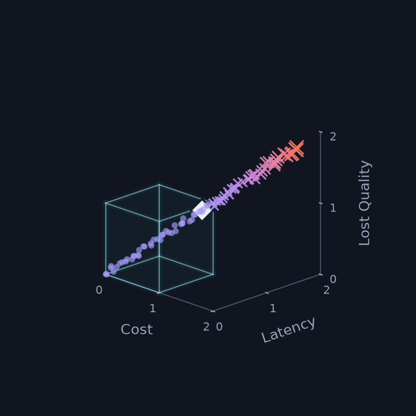
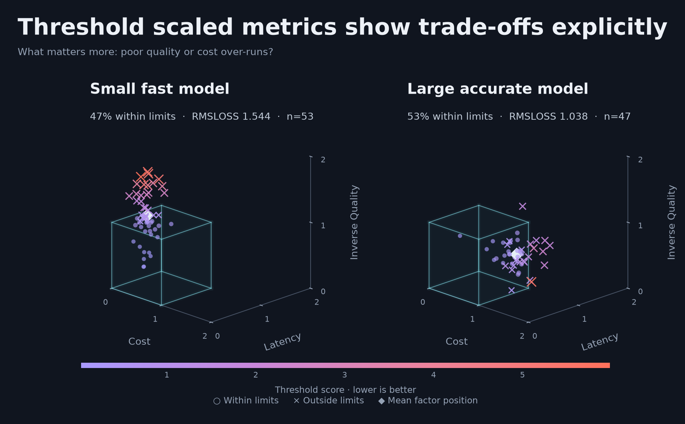
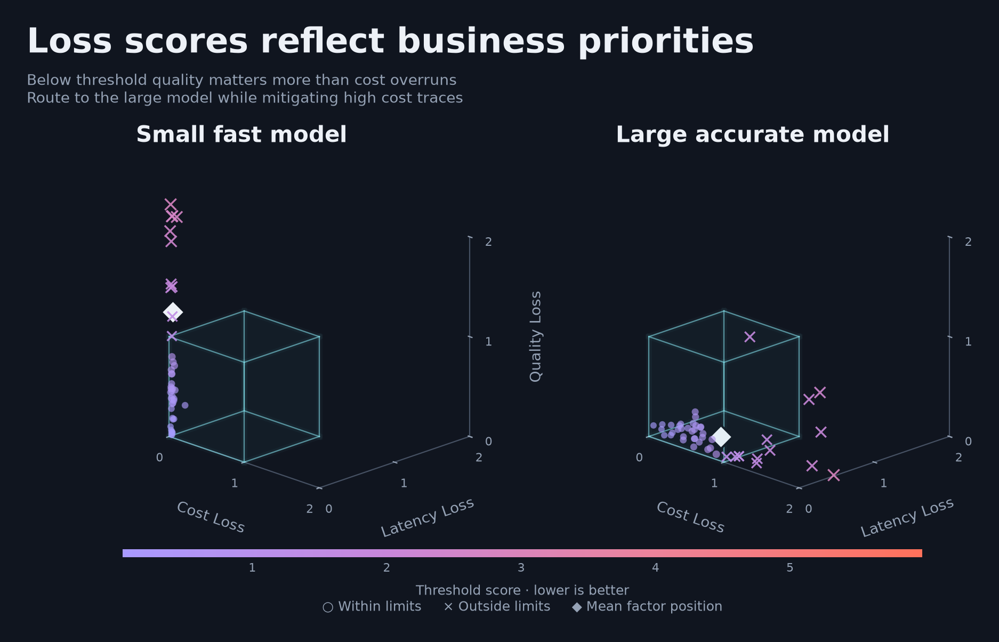

# Threshold-aware agent scoring

Companion code for the Towards Data Science article *What's in the Box?!: Turning Scattered Requirements into Deployable Agents* ([link]).

One score for choosing agent configurations: product, finance, engineering, and risk requirements turned into a single, threshold-aware decision rule.



## The idea

Production agents have to be accurate, on budget, and fast. Most teams already have the ingredients (PM requirements, finance budgets, SLOs, traces, eval datasets) but lack a clean translation layer between those objectives and agent configuration decisions.

- **Product** sets quality floors.
- **Finance** sets cost ceilings.
- **Engineering** sets latency and reliability thresholds.
- **Risk** sets policy constraints.

Every config is scored against the same box. Stay inside the box first, then optimize within it.

Component metrics still tell you *why* an agent failed. The score tells you *which config to ship*.

## Quick start

Requires Python 3.11+. With [uv](https://docs.astral.sh/uv/):

```bash
git clone https://github.com/doc1000/agent_threshold_score.git
cd agent_threshold_score
uv sync
uv run jupyter lab threshold_analysis.ipynb
```

Or with pip:

```bash
pip install numpy pandas matplotlib jupyterlab
jupyter lab threshold_analysis.ipynb
```

Run the notebook top to bottom. It generates 100 synthetic traces split between a small fast model and a large accurate model, scores them, and writes the figures to `figures/`.

## Repository contents

| File | What it is |
|---|---|
| `threshold_analysis.ipynb` | Scoring functions, synthetic traces, summaries, and figures |
| `figures/` | Figures used in the article (created by the notebook) |
| `pyproject.toml`, `uv.lock` | Dependencies |

## How the score works

| Term | Meaning |
|---|---|
| τ (tau) | threshold: the line you do not want to cross |
| k | how sharply the penalty rises after crossing it |
| λ (lambda) | relative business priority, most important inside the box |
| L2 norm | combined distance from the ideal |
| threshold-corner normalization | a score of 1.0 means every factor is exactly at threshold |
| RMSLoss | config-level aggregate that penalizes both mean and variance |

1. **Normalize each metric into "badness"** (`normalized_badness`) so every factor reads the same way: below 1 is inside the box, 1 is the threshold, above 1 is outside. Lower-is-better metrics are divided by τ; quality becomes `(1 − quality) / (1 − τ)`.
2. **Apply a smooth threshold loss** (`threshold_loss`): `softplus(k · (x − 1))²`. Nearly flat inside the box, roughly quadratic outside. With small k, the weights can still rank configs that are all inside the box; with large k, only violations matter.
3. **Combine factors per trace** (`score_traces`) with λ-weighted L2 aggregation, normalized so the threshold corner scores 1.0.
4. **Aggregate traces per config** (`RMSLoss`). Trace scores are right-skewed and close to log-normal, so RMSLoss works on `log1p(score)`, where RMS² = mean² + variance, then maps back to the score scale. Two configs with the same typical score are separated by their tails.

```python
metric_config = {
    "cost":    {"column": "cost_usd",        "direction": "lower_is_better",  "tau": 0.12, "k": 3, "lambda": 1.0},
    "latency": {"column": "latency_seconds", "direction": "lower_is_better",  "tau": 7.0,  "k": 3, "lambda": 1.0},
    "quality": {"column": "quality_score",   "direction": "higher_is_better", "tau": 0.80, "k": 3, "lambda": 1.0},
}

scored = score_traces(traces, metric_config)
summary = (
    scored.groupby("config")
          .agg(traces=("trace_id", "count"),
               RMSL=("threshold_score", RMSLoss),
               mean_score=("threshold_score", "mean"),
               median_score=("threshold_score", "median"),
               inside_box_rate=("inside_box", "mean"))
)
```

`traces` needs one row per trace with a `config` column and one column per metric. The notebook also includes a SQLite loader (`use_sql = True`) for pulling traces from a database.

Thresholds here are illustrative. Each one should trace back to a business fact: a budget divided by expected volume, the latency at which users give up, the accuracy below which humans redo the work anyway.

## Sample result



| config | traces | RMSL | mean | median | log1p std | inside-box rate |
|---|---|---|---|---|---|---|
| large_accurate_model | 47 | 1.04 | 0.99 | 0.62 | 0.36 | 0.53 |
| small_fast_model | 53 | 1.54 | 1.50 | 0.63 | 0.58 | 0.47 |

The typical trace scores almost the same for both models. The difference is in the tail: the small model's quality failures spread its scores out, and those misses decide the comparison. Tighten the cost ceiling or raise the cost weight and the answer could flip. That is a conversation for the people who set the box.



## Using it with your eval stack

This is a scoring layer, not a replacement for your eval framework. Log the threshold score as a custom evaluator or scorer in LangSmith, Phoenix, Braintrust, Weave, DeepEval, or MLflow, or use it as an optimization metric in DSPy. Worth logging alongside it: raw metrics, normalized badness, component losses, `inside_box`, config metadata, and the scoring-profile version.

## Adopting it with your team

1. Start with three metrics.
2. Set thresholds in a meeting with product, finance, engineering, and risk.
3. Score recent traces.
4. Inspect failures.
5. Create new configurations and optimize prompts, workflows, memory, or models.
6. Adjust thresholds only when the business meaning changes.
7. Use the scalar score for selection, and component metrics for diagnosis.
8. Version the scoring profile (every τ, k, and λ) alongside the agent config, so a score change can be traced to an agent change or a policy change.

## Related

- [Stop ranking agent configs by average score](https://towardsdatascience.com/stop-ranking-agent-configs-by-average-score/): head-to-head comparison of model, tool, and prompt combinations.

## About me

Doster Esh – AI powered data scientist and former power trader and quant. I look for ways to structure messy decision spaces, combine statistical and machine-learning methods with AI agents, and turn those ideas into practical tools. Find me at [www.knowledgealgorithms.com](https://www.knowledgealgorithms.com).
